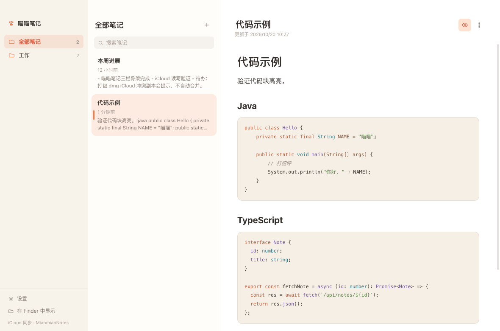

<div align="center">


<h1>喵喵笔记 · Miaomiao Notes</h1>

<p><strong>一只喵喵的本地 Markdown 笔记应用</strong><br />
<sub>A cute, local-first Markdown notes app for macOS</sub></p>

<p>
  <a href="https://miao.wordtk.com"></a>
  
  
  
</p>

<p>
  <a href="README.md">🇺🇸 English</a> ·
  <a href="https://miao.wordtk.com/stats">📊 使用数据</a>
</p>

</div>

---



## 为什么又做一个笔记软件？

因为笔记应该是**文件**，而不是别人数据库里的一行记录。

- 三栏布局参考 macOS 备忘录：文件夹 → 笔记 → 内容
- 每条笔记都是 iCloud Drive 里的普通 `.md` 文件，多台 Mac 免费同步
- 没有账号、没有服务器、没有订阅——完全免费，不需要登录
- 界面刻意做小做暖——一套认真打磨的主题，而不是二十套凑数的皮肤

## 功能

| 模块 | 说明 |
| --- | --- |
| 布局 | 文件夹栏、笔记栏、编辑区，原生 macOS 窗口 |
| 编辑 | CodeMirror 6、Markdown 语法高亮、实时预览（⌘E） |
| 存储 | 普通 `.md` 文件；有 iCloud 用 iCloud，没有则用 `~/Documents` |
| 同步 | 依赖 macOS 自带 iCloud Drive，不引入额外服务 |
| 安全 | 原子写入、`.trash` 软删除、iCloud 冲突检测 |
| 界面 | 中英双语，深浅两套主题 |
| 更新 | 设置里手动检查，另外每天最多静默检查一次 |

## 环境要求

- macOS 12 及以上（Apple Silicon 或 Intel）
- iCloud Drive 可选——没有它，笔记库会放在 `~/Documents/MiaomiaoNotes`

## 安装

去 **[miao.wordtk.com](https://miao.wordtk.com)** 下载最新版，打开 dmg
把应用拖进「应用程序」即可。

构建用的是 ad-hoc 签名、没有公证，所以**首次打开需要右键 → 打开**。之后就能正常双击启动了。

## 本地开发

```bash
npm install
npm run dev      # Vite + Electron 热更新
npm run start    # 构建一次后启动 Electron
npm run dist     # 打包 macOS dmg（arm64 + x64）
```

## 笔记存在哪

```
~/Library/Mobile Documents/com~apple~CloudDocs/MiaomiaoNotes/   # 有 iCloud
~/Documents/MiaomiaoNotes/                                      # 没有 iCloud
```

路径在首次启动时确定一次并存进设置，所以之后登录 iCloud 也不会突然换位置。
随时可以在 **设置 → 存储** 里改，改的只是指向，不会移动或删除任何文件。

## iCloud 冲突怎么处理

iCloud 是最终一致同步。同一篇笔记在两台 Mac 上编辑、且还没同步回来时，iCloud 会生成 `笔记 2.md` 这样的副本。喵喵笔记的做法是：

- 写入前后都检测冲突副本
- 在编辑区顶部给出黄色提示条
- **绝不自动合并**——静默合并丢数据的概率，比让人手动处理高得多

## 隐私

- 应用只发送一条匿名启动信号（随机设备 ID），别的什么都不发
- 不存 IP、不存 UA、不存硬件信息
- 开关在 **设置 → 行为 → 匿名使用统计**
- 官网没有统计、没有广告、没有 Cookie、没有第三方请求

## 项目结构

```
electron/      主进程：窗口、笔记库路径、文件读写、原生菜单、IPC
src/           渲染进程：三栏 UI、CodeMirror 编辑器、Markdown 预览
src/styles/    设计变量与主题（换肤只需新增一个 [data-theme] 块）
build/         应用图标源文件（SVG + 生成的 icns）
site/          官网：Cloudflare Worker + 静态资源
```

渲染进程不直接碰文件系统，所有能力都通过 `contextBridge` 暴露的窄接口，
并且开启了 `contextIsolation` 与 sandbox。

## 开源协议

双轨授权：

- **开源** —— [AGPL-3.0-only](LICENSE)。可自由使用、修改、自行部署。
  如果你分发修改后的版本，或把它作为网络服务对外提供，AGPL 要求你同样公开对应源码。
- **商业授权** —— 如果 AGPL 不适合你的产品（例如要发布闭源衍生版本），
  可购买商业授权，联系 **hello@wordtk.com**。

「喵喵笔记 / Miaomiao Notes」名称与猫脸图标不在开源授权范围内。
